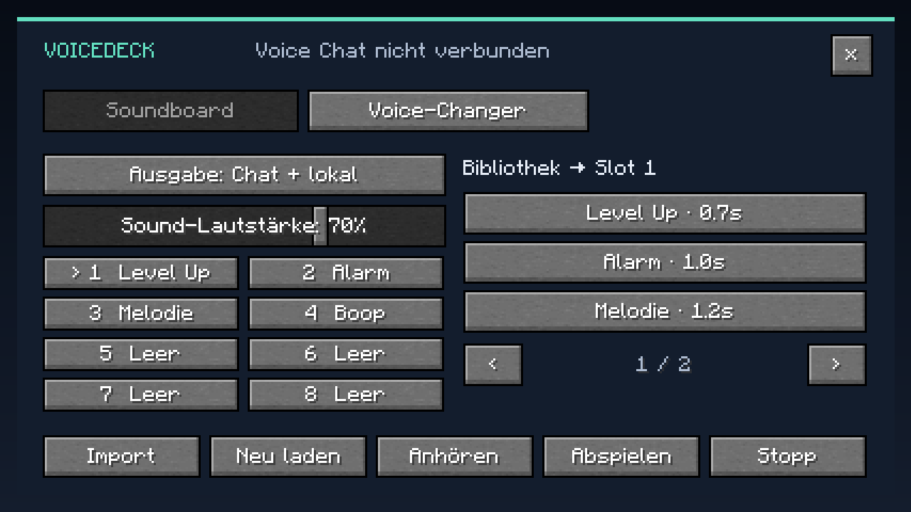
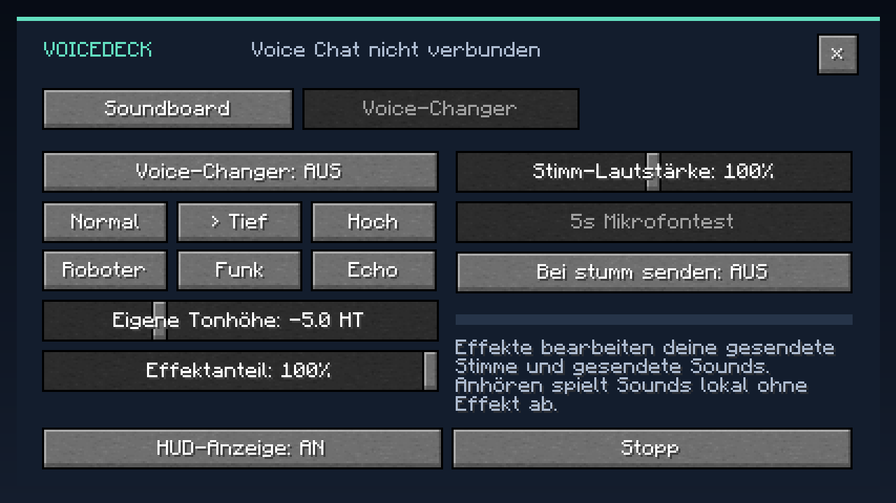
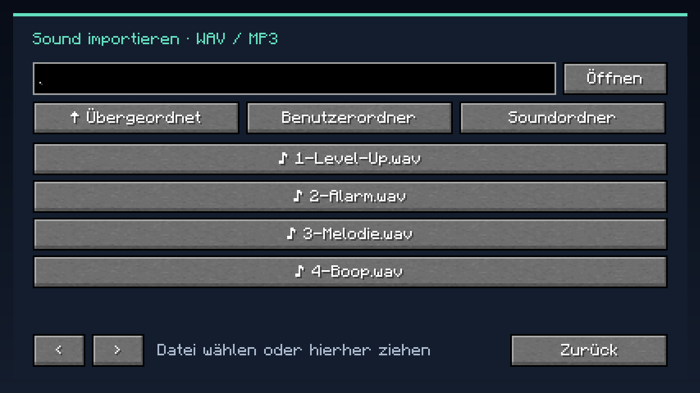

# VoiceDeck für Minecraft

Ein Soundboard und Echtzeit-Voice-Changer mit vollständiger Bedienung **in Minecraft Java 26.3 mit Fabric**. Die Mod wird nur auf deinem Client installiert.

**[Mod herunterladen](https://github.com/DunklerK3ks/VoiceDeck/releases/latest)** · [Direkte JAR im Repository](downloads/voicedeck-1.1.0%2B26.3.jar) · [Downloads & Prüfsummen](downloads/README.md) · [Changelog](CHANGELOG.md)



## Screenshots

### Voice-Changer



### Dateibrowser im Spiel



Die Screenshots stammen aus einem echten Minecraft-26.3-Testclient. Im abgebildeten Hauptmenü besteht keine Server-Verbindung; eine Voice-Chat-Verbindung wird beim Betreten eines geeigneten Servers hergestellt.

## Installation

1. Ein Minecraft-Java-Profil für **26.3 mit Fabric Loader 0.19.5 oder neuer** anlegen: [Fabric Installer](https://fabricmc.net/use/installer/).
2. Die für 26.3 passende [Fabric API](https://modrinth.com/mod/fabric-api/versions?g=26.3) in den `mods`-Ordner dieses Profils legen.
3. Ältere VoiceDeck-JAR-Dateien aus diesem `mods`-Ordner entfernen und `voicedeck-1.1.0+26.3.jar` hineinlegen.
4. Für Voice-Changer, Soundübertragung und MP3-Import zusätzlich [Simple Voice Chat für Fabric 26.3, Version 2.6.24 oder neuer](https://modrinth.com/plugin/simple-voice-chat/versions?g=26.3&l=fabric) installieren.
5. Minecraft mit diesem Profil starten. **B** öffnet VoiceDeck. Im Titel- und Pausemenü gibt es außerdem einen VoiceDeck-Button.

Die 26.3-Ausgabe von Simple Voice Chat 2.6.24 wird vom Herausgeber als Beta angeboten. Diese VoiceDeck-Version wurde mit genau dieser Ausgabe getestet.

Minecraft 26.3 benötigt Java 25. Andere Minecraft-Versionen und Forge/NeoForge werden von dieser JAR nicht unterstützt.

Für andere Spieler muss Simple Voice Chat auf dem Server eingerichtet und verbunden sein. Diese Spieler brauchen Simple Voice Chat; VoiceDeck selbst brauchen sie nicht. Es gelten die normalen Voice-Chat-Regeln für Nähe, Gruppen und Flüstern. Das lokale WAV-Soundboard funktioniert auch ohne Simple Voice Chat.

## Soundboard

- Vier selbst erzeugte Beispielsounds sind enthalten: Level Up, Alarm, Melodie und Boop.
- Links einen der acht Slots auswählen. Rechts einen Sound anklicken, um ihn diesem Slot zuzuweisen.
- **Import** öffnet einen Dateibrowser innerhalb Minecrafts. Ordner durch Anklicken öffnen; alternativ einen Datei-/Ordnerpfad eingeben und „Öffnen“ drücken. WAV- oder MP3-Dateien können auch auf das VoiceDeck-Menü gezogen werden.
- **Abspielen** spielt den ausgewählten Slot entsprechend dem gewählten Ausgabemodus ab.
- **Anhören** spielt ausschließlich lokal und sendet nichts.
- Die Ausgabe lässt sich zwischen **Nur lokal**, **Voice Chat** und **Chat + lokal** wechseln.
- **Stopp** beendet die laufenden Sounds und einen eventuell laufenden Mikrofontest. Ein neuer Sound ersetzt den vorherigen; es läuft jeweils ein Sound pro Ausgabe.
- Sounds werden ohne gedrückte Sprechtaste gesendet. Ein funktionierendes Voice-Chat-Mikrofon wird für dessen Audiotakt trotzdem benötigt.
- Bei stummgeschaltetem Mikrofon wird standardmäßig nichts gesendet. Die bewusste Einstellung **„Bei stumm senden: AN“** erlaubt Soundboard-Senden bei stummem Mikrofon. Deaktivierter oder getrennter Voice Chat sendet nichts.
- WAV/MP3 werden auf 48 kHz, 16 Bit, mono umgerechnet. Grenzen: 120 Sekunden und 24 MB je Datei, 64 Sounds und ungefähr 24 Minuten Audio je Bibliothek. PCM-WAV wird vom Java-Audiodecoder gelesen; MP3 braucht Simple Voice Chat.

Die lokale Wiedergabe nutzt das Standard-Audiogerät des Betriebssystems und den VoiceDeck-Lautstärkeregler. Minecrafts Musik- oder Master-Lautstärkeregler steuern diese lokale Wiedergabe nicht.

## Voice-Changer

Im Reiter **Voice-Changer** den Schalter einschalten und ein Preset wählen:

| Preset | Wirkung |
| --- | --- |
| Normal | Unveränderte Tonhöhe, einstellbare Lautstärke |
| Tief | 5 Halbtöne tiefer |
| Hoch | 7 Halbtöne höher |
| Roboter | Ringmodulation mit 70 Hz |
| Funk | Bandbegrenzung und Verzerrung |
| Echo | Echo mit 180 ms Verzögerung |

Der Regler **Eigene Tonhöhe** aktiviert eine frei wählbare Tonhöhe zwischen −12 und +12 Halbtönen. Effektanteil und Stimm-Lautstärke sind einstellbar. Der Voice-Changer startet standardmäßig ausgeschaltet.

Bearbeitet wird das ausgehende Voice-Chat-Signal, einschließlich Sounds, die gleichzeitig über das Soundboard gesendet werden. Eingehende Stimmen und normale Minecraft-Spielgeräusche bleiben unverändert. „Anhören“ spielt Soundboard-Dateien lokal ohne Voice-Changer ab. Bei „Chat + lokal“ hörst du die lokale Originaldatei, während die anderen Spieler das bearbeitete Signal hören. Für Pitch-Presets entstehen durch die Audiopuffer bis zu etwa 60 ms zusätzliche Verzögerung; bei Echo kann das Ende nach Loslassen der Sprechtaste abgeschnitten werden.

**5s Mikrofontest** zeichnet die aktivierte Stimme mit dem gewählten Effekt fünf Sekunden lang auf und spielt sie anschließend nur dir vor. Während der Aufnahme werden deine Sprachpakete nicht an den Server gesendet. Dafür muss Voice Chat verbunden und das Mikrofon aktiv sein; bei Push-to-Talk während des Tests die Sprechtaste halten. Ohne erkannte Sprache erscheint eine entsprechende Meldung.

## Tasten

| Taste | Funktion |
| --- | --- |
| B | Menü öffnen |
| R | Voice-Changer ein-/ausschalten |
| Num 1 bis Num 8 | Sound des jeweiligen Slots abspielen |
| Num 0 | Alle Sounds / Mikrofontest stoppen |

Alle Tasten sind unter **Optionen → Steuerung → Tastenbelegung → VoiceDeck** änderbar. Bei Verwendung des Nummernblocks Num-Lock einschalten. Für Tastaturen ohne Nummernblock andere Tasten zuweisen.

## Einstellungen und eigene Dateien

Unter dem Spielordner des verwendeten Minecraft-Profils:

```text
config/voicedeck/config.json
config/voicedeck/sounds/
```

Einstellungen und Slot-Zuweisungen werden gespeichert. Der Import kopiert Audiodateien in den Soundordner und überschreibt bereits vorhandene andere Dateien nicht. „Neu laden“ liest neue oder geänderte Dateien aus diesem Ordner erneut ein. Eine beschädigte Konfiguration wird als `.invalid-<Zeitstempel>` gesichert und durch Standardwerte ersetzt.

## Aus dem Quellcode bauen

JDK 25 installieren und `JAVA_HOME` auf das JDK setzen. Der Gradle Wrapper lädt die benötigte Gradle-Version automatisch; die erste Ausführung lädt außerdem Minecraft- und Mod-Abhängigkeiten.

```powershell
.\gradlew.bat build
```

Linux/macOS:

```sh
sh ./gradlew build
```

Die fertige Mod liegt in `build/libs/voicedeck-1.1.0+26.3.jar`. Die `-sources.jar` ist ausschließlich für Entwickler.

GitHub Actions baut die Mod mit Java 25 und führt die Audiotests bei Änderungen auf `main` sowie bei Pull Requests aus.

```powershell
.\gradlew.bat runClient
.\gradlew.bat runClient -Psmoke
.\gradlew.bat runClient -Psmoke -PwithoutVoiceChat
```

Der separate Smoke-Test öffnet Soundboard, Voice-Changer und den Ingame-Dateibrowser, erstellt Screenshots unter `run-26.3/screenshots` und beendet den Entwicklungsclient. Sein Code wird nicht in die ausgelieferte Mod aufgenommen. Der Lauf ohne Voice Chat prüft die optionale Anbindung.

## Validierung

27 bestandene JUnit-Tests prüfen tatsächliche Frequenzänderung, PCM-Limits, Frame-Längen, Stereo-/Sampleraten-Konvertierung, WAV-Roundtrip, Mikrofontest-Aufnahme, Verhalten bei Stumm/Disconnect und Konfigurationsspeicherung. Die Entwicklungsclients wurden mit und ohne Simple Voice Chat erfolgreich gestartet; Soundboard, Voice-Changer und Dateibrowser wurden im echten Minecraft-Renderer geprüft. Zusätzlich wurden synthetische Audiodaten durch Simple Voice Chats registrierte Events geschickt: Die Sprachbearbeitung wurde angewendet und der Mikrofontest hat das ausgehende Audio-Event abgebrochen. Ein Gespräch mit zwei Spielern auf einem echten Server muss zusätzlich im eigenen Setup getestet werden.

Die Voice-Chat-Anbindung verwendet die offizielle [Simple Voice Chat API](https://modrepo.de/minecraft/voicechat/api/getting_started), insbesondere [MergeClientSoundEvent](https://voicechat.modrepo.de/de/maxhenkel/voicechat/api/events/MergeClientSoundEvent.html) und [ClientSoundEvent](https://voicechat.modrepo.de/de/maxhenkel/voicechat/api/events/ClientSoundEvent.html).

Lizenz der Mod und der erzeugten Beispielsounds: MIT. Minecraft, Fabric API und Simple Voice Chat sind separate Projekte mit ihren jeweiligen Lizenzen.
