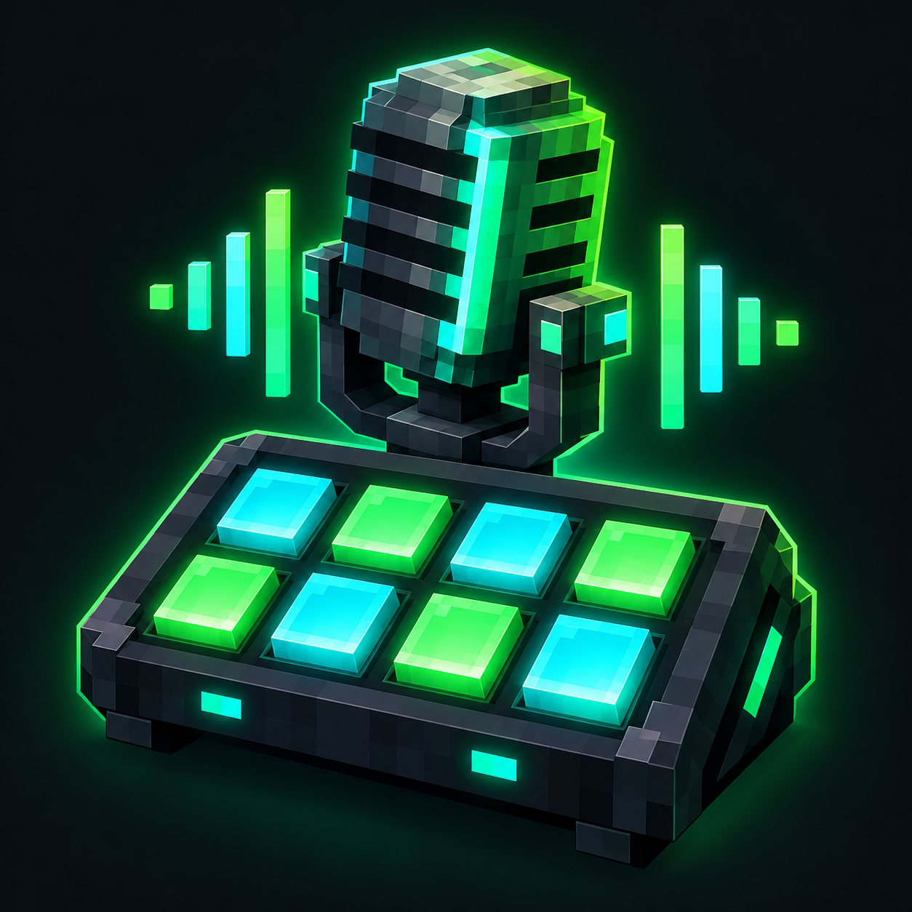

# SoundDeck project icon

Created for the Modrinth listing **SoundDeck for Simple Voice Chat**. The underlying mod and GitHub repository are currently named VoiceDeck.

Generated with the built-in image generation tool. The icon combines a voxel microphone, eight soundboard pads, and green/cyan sound waves on a dark background. No official Minecraft, Modrinth, or Simple Voice Chat logo is used.



The JPEG is the upload copy for Modrinth's 512 KiB icon limit. The original PNG is preserved in the local workspace.

## Generation prompt

```text
Use case: logo-brand
Asset type: square Modrinth project icon, Minecraft mod SoundDeck for Simple Voice Chat.
Primary request: Create a polished, original gaming logo as a square app icon. Combine one chunky voxel microphone with a compact soundboard deck with eight glowing square pads arranged in two rows of four. The microphone stands just behind the deck and the objects read as one memorable silhouette. Add a small stepped sound wave accent. Minecraft-inspired pixel/voxel aesthetic with clean strong silhouettes, carefully aligned edges, restrained beveled 3D shading.
Composition: centered emblem fills about 75 percent of the square, substantial safe padding, very readable at 96 and 48 pixels. No lettering, no words, no characters.
Color palette: emerald green and electric cyan highlights on a charcoal midnight background; tasteful green edge glow, crisp contrast. Full square opaque dark background, no outside border, no watermark.
Constraints: original emblem only; no official Minecraft, Modrinth, or Simple Voice Chat logo; no fake screenshot; no photorealism, no tiny intricate details. Finish as a premium, clean square project icon.
```

